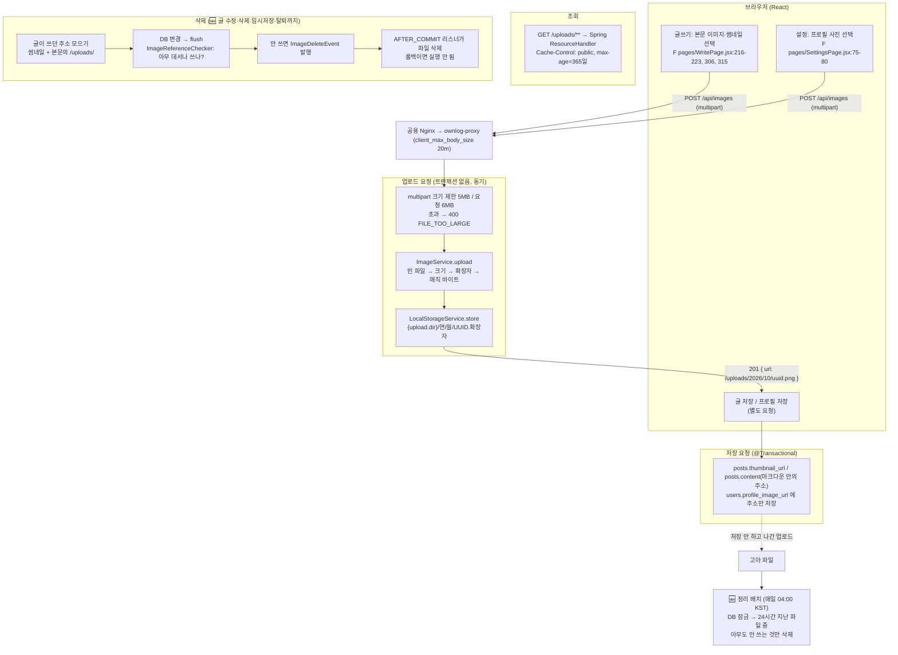

# 이미지 처리 흐름 (업로드 → 검증 → 저장 → 조회 → 삭제)

> 2026-10-16 기준 코드를 읽고 정리한 문서예요.
> **같은 날 개선 A·B를 구현했어요** (`feature/post-image-cleanup`). 2~4장은 **구현 전 상태**를 기록으로 남기고, 바뀐 곳은 🆕로 표시했어요.
> 공부하려면 **[7장 공부 가이드](#7-공부-가이드-구현-따라가기)** 부터 보세요.
> - ✅ **확인**: 코드에서 직접 확인한 내용 (근거 `파일:라인`)
> - 🔎 **추정**: 코드에 근거가 없거나 라이브러리 기본값·동작에 기대는 내용
> - ❓ **확인 불가**: 레포 밖(서버 설정 등)에 있어서 확인할 수 없는 내용

경로 줄임말: `B` = `backend/src/main/java/com/ownlog/`, `R` = `backend/src/main/resources/`, `F` = `frontend/src/`

---

## 1. 흐름도



---

## 2. 현재 구현 (1단계)

### 2-1. 검증

| 항목 | 현재 구현 | 근거 |
|---|---|---|
| 크기 제한 (Spring) | 파일 5MB, 요청 전체 6MB | ✅ `R application.yaml:16-18` |
| 크기 초과 응답 | `MaxUploadSizeExceededException` → 400 `FILE_TOO_LARGE` | ✅ `B global/error/GlobalExceptionHandler.java:75-77` |
| 크기 재확인 | 서비스에서 5MB 한 번 더 | ✅ `B image/service/ImageService.java:23, 32-34` |
| 빈 파일 | 400 `INVALID_FILE_TYPE` | ✅ `ImageService.java:29-31` |
| 확장자 | 파일 이름 확장자가 jpg·jpeg·png·gif·webp인지 (대소문자 무시) | ✅ `ImageService.java:35-37`, `B global/storage/ImageType.java:53-60` |
| MIME (Content-Type) | **검사하지 않음.** 클라이언트가 보낸 값을 믿지 않는다고 명시 | ✅ `ImageService.java:17` |
| 매직 바이트 | **검사함.** 앞 12바이트로 JPEG·PNG·GIF·WEBP 판별, 아니면 거부 | ✅ `ImageService.java:38-39`, `ImageType.java:22-51` |
| SVG | 허용 안 함 (스크립트를 넣을 수 있어서) | ✅ `ImageType.java:12` |
| 저장 확장자 | 사용자가 보낸 이름이 아니라 **판별된 형식** 기준 | ✅ `ImageService.java:27, 42` |
| 프록시 크기 제한 | 우리 프록시 `client_max_body_size 20m` | ✅ `deploy/deploy.sh:138` |
| 공용 Nginx 크기 제한 | — | ❓ 서버 설정이라 확인 불가 (Nginx 기본값은 1MB) |

### 2-2. 저장

| 항목 | 현재 구현 | 근거 |
|---|---|---|
| 저장소 | 서버 디스크 (`StorageService` 인터페이스의 `LocalStorageService` 구현) | ✅ `B global/storage/StorageService.java:9-16`, `LocalStorageService.java:17` |
| 경로 | `{ownlog.upload.dir}/{연}/{월}/{UUID}.{확장자}`, 날짜는 한국 시간 | ✅ `LocalStorageService.java:27-40` |
| 업로드 폴더 | 로컬 `${UPLOAD_DIR:./uploads}`, 운영 `/app/uploads` | ✅ `R application.yaml:24-25`, `R application-prod.yaml:25-26` |
| 운영 볼륨 | 서버 `~/ownlog-uploads` → 컨테이너 `/app/uploads` | ✅ `deploy/deploy.sh:24, 108` |
| 파일 이름 | `UUID.randomUUID()`, 사용자가 올린 이름은 쓰지 않음 | ✅ `LocalStorageService.java:31-32`, `StorageService.java:11` |
| 덮어쓰기 | `Files.copy(InputStream, Path)`는 같은 이름이 있으면 실패 (UUID라 사실상 없음) | ✅ `LocalStorageService.java:36` / 🔎 JDK 동작 |
| DB 컬럼 | **이미지 전용 테이블이 없어요.** 주소 문자열만 `posts.thumbnail_url`, `posts.content`(마크다운 본문 안), `users.profile_image_url`에 저장. 업로드한 사람·크기·형식은 기록하지 않음 | ✅ `V1~V6`의 `CREATE TABLE`(이미지 테이블 없음), `B post/domain/Post.java:67`, `B global/storage/ImageReferenceChecker.java:9` |
| 저장할 수 있는 주소 | 썸네일 `/uploads/` 또는 `https://`, 프로필 `/uploads/`만 | ✅ `B post/dto/PostRequest.java:20-21`, `B user/dto/ProfileUpdateRequest.java:16-17` |
| 썸네일 자동 지정 | 썸네일이 없으면 본문 첫 이미지 | ✅ `Post.java:183, 189` |

### 2-3. 조회

| 항목 | 현재 구현 | 근거 |
|---|---|---|
| 방식 | **Spring이 직접 제공** (`/uploads/**` ResourceHandler). Nginx 정적 서빙 아님 | ✅ `B global/config/WebConfig.java:28-32` |
| 캐시 | `Cache-Control: public, max-age=365일` (UUID라 내용이 안 바뀜) | ✅ `WebConfig.java:18, 32` |
| 권한 | `GET /uploads/**` 누구나 | ✅ `B global/config/SecurityConfig.java:62` |
| Nginx로 바꾸기 | "배포할 때는 Nginx가 직접 제공하게 바꾸면 더 빨라요"라는 주석만 있음 (미적용) | ✅ `WebConfig.java:19` |

### 2-4. 삭제

| 상황 | 현재 구현 | 근거 |
|---|---|---|
| 프로필 사진 변경 | 트랜잭션 안에서 다른 곳이 쓰는지 확인 → 이벤트 발행 → **커밋 뒤** 파일 삭제 | ✅ `B user/service/UserService.java:42-51, 96-99`, `B global/storage/ImageDeleteListener.java:18-21` |
| 탈퇴 | 프로필 사진만 위와 같이 커밋 뒤 삭제. **내 글의 이미지는 지우지 않음** (DB 행만 삭제) → 🆕 내 글 이미지도 커밋 뒤 정리 (`UserService.java:96`) | ✅ `UserService.java:72-92`, `B user/repository/WithdrawalCleaner.java:22-34` |
| 글 삭제 | 신고·댓글·좋아요·북마크·링크·글 DB 행만 삭제. **이미지 파일 삭제 없음** → 🆕 커밋 뒤 정리 (`PostService.java:81, 88`) | ✅ `B post/service/PostService.java:71-80` |
| 글 수정 (썸네일·본문 이미지 교체) | 예전 이미지 파일 삭제 없음 → 🆕 **뺀 이미지만** 커밋 뒤 정리 (`PostService.java:64, 72-73`), 임시저장·발행도 같음 (`DraftService.java`) | ✅ `PostService.java:55-68` (이벤트 발행 없음) |
| 순서 | **DB 커밋 → 파일 삭제** (`AFTER_COMMIT`) | ✅ `ImageDeleteListener.java:8-11, 18` |
| 파일 삭제 실패 | 로그만 남기고 요청은 성공 | ✅ `LocalStorageService.java:53-57` |
| 경로 조작 | 업로드 폴더 밖이면 지우지 않음, 외부 주소는 무시 | ✅ `LocalStorageService.java:45-52` |
| 남의 파일 보호 | 다른 회원 프로필·글 썸네일·본문(LIKE)에서 쓰면 지우지 않음 | ✅ `ImageReferenceChecker.java:19-26` |

### 2-5. 실행 방식

| 항목 | 현재 구현 | 근거 |
|---|---|---|
| 동기/비동기 | **동기.** 요청 스레드에서 검증·저장 후 응답. `@Async`, `@EnableAsync` 없음 | ✅ `ImageService.java:28-46`, 저장소 전체 검색 결과 없음 |
| 삭제 리스너 | `@TransactionalEventListener(AFTER_COMMIT)`, `@Async` 없음 → 커밋한 요청 스레드에서 동기로 실행 | ✅ `ImageDeleteListener.java:18` / 🔎 Spring 기본 동작 |
| 리사이징·썸네일 생성 | **없음.** 원본을 그대로 저장 | ✅ `ImageService.java`, `LocalStorageService.java` (처리 코드 없음) |
| EXIF(위치 정보 등) 제거 | **없음.** 원본 그대로 | ✅ 처리 코드 없음 |
| 정리 배치 | **없음.** `@Scheduled`, `@EnableScheduling` 없음 → 🆕 `OrphanImageCleanupJob` (매일 04:00 KST) | ✅ 저장소 전체 검색 결과 없음 (구현 전) |

### 2-6. `@Transactional` 범위

| 요청 | 트랜잭션 | 파일 I/O 위치 | 근거 |
|---|---|---|---|
| 업로드 `POST /api/images` | **없음** (DB를 쓰지 않음) | 트랜잭션 밖 | ✅ `ImageService.java` (`@Transactional` 없음), `ImageController.java:21-24` |
| 프로필 변경·탈퇴 | 있음 | 삭제는 **커밋 뒤** (트랜잭션 밖) | ✅ `UserService.java:42, 72`, `ImageDeleteListener.java:18` |
| 글 저장·수정·삭제 | 있음 | 파일 I/O 없음 | ✅ `PostService.java:38, 55, 71` |
| DB 연결 점유 | `open-in-view: false` → 업로드 요청은 DB 커넥션을 잡지 않음 | ✅ `R application.yaml:14` |

### 2-7. 블루-그린과 업로드 볼륨

| 항목 | 현재 구현 | 근거 |
|---|---|---|
| 두 색이 같은 폴더를 쓰나 | **공유해요.** blue·green 모두 같은 `docker run` 줄로 `-v "$UPLOAD_DIR:/app/uploads"` | ✅ `deploy/deploy.sh:24, 100-109` |
| 파일 권한 | 컨테이너를 서버 계정(`--user`)으로 실행해서 같은 폴더에 쓰기 가능 | ✅ `deploy/deploy.sh` (`--user "$(id -u):$(id -g)"`) |
| docker-compose | 로컬 PostgreSQL만 있고 앱·업로드 볼륨은 없음 | ✅ `docker-compose.yml` |
| 전환 중 업로드 | 업로드는 파일 하나를 쓰고 끝나는 요청이라, 예전 색에서 받은 파일도 같은 폴더에 남음 | 🔎 공유 볼륨 + graceful shutdown 기준 추정 |
| 운영 반영 | 블루-그린(v1.2.0)은 **운영 반영 미확인**. 운영(v1.1.0)은 컨테이너 1개에 같은 볼륨 | ❓ |

---

## 3. 설계 결정 이유

> 코드 주석에 이유가 적혀 있는 것은 ✅, 적혀 있지 않아 추론한 것은 🔎예요.

### 3-1. 저장소: 서버 디스크
| | 내용 |
|---|---|
| 고른 것 | 서버 디스크 + Docker 볼륨, `StorageService` 인터페이스로 감쌈 |
| 이유 | 서버 한 대, 외부 계정·비용 없이 바로 동작 (🔎). 인터페이스 주석에 "배포 B안(PaaS)으로 가면 Cloudinary 같은 구현체로 바꿔요 (요구사항 8장 결정)"이라고 되어 있어, **바꿀 수 있게 열어 둔** 선택이에요 (✅ `StorageService.java:5-8`) |
| 버린 대안 | **S3·Cloudinary 같은 외부 저장소**: 키 관리·비용·외부 의존이 생김 (🔎). **DB에 BLOB 저장**: DB가 커지고 백업·조회가 무거워짐 (🔎) |
| 대가 | 서버를 여러 대로 늘리면 폴더를 공유할 방법이 필요해요. 디스크가 차면 업로드가 실패해요 |

### 3-2. 동기 처리
| | 내용 |
|---|---|
| 고른 것 | 요청 스레드에서 바로 검증·저장하고 주소를 돌려줌 |
| 이유 | 파일이 5MB 이하이고 후처리(리사이징)가 없어서, 저장이 끝나야 쓸 수 있는 주소를 바로 줄 수 있어요 (🔎) |
| 버린 대안 | **`@Async` 비동기 저장**: 주소를 먼저 주면 저장이 실패했을 때 깨진 이미지가 생기고, 실패를 알릴 방법(상태 조회 API 등)이 따로 필요해요 (🔎) |

### 3-3. 리사이징 없음
| | 내용 |
|---|---|
| 고른 것 | 원본 그대로 저장 |
| 이유 | 2주 MVP 범위 밖. README "다음 단계"에 "이미지 정리(리사이즈, 글 삭제 시 파일 정리)"로 남겨 둠 (✅ README 8장) |
| 버린 대안 | **업로드 때 바로 리사이징**: 이미지 라이브러리 추가와 CPU 사용, 요청 시간이 늘어남 (🔎). **조회 때 변환(on-the-fly)**: 캐시 설계가 필요 (🔎) |
| 대가 | 큰 사진이 그대로 전송돼서 화면이 느려지고 디스크를 더 써요. EXIF의 촬영 위치 정보도 그대로 남아요 |

---

## 4. 롤백 처리: 실패 케이스 (2단계)

| # | 케이스 | 현재 동작 | 판정 | 근거 |
|---|---|---|---|---|
| 1 | **파일 저장 실패** (디스크 가득, 권한 없음) | `Files.copy`가 실패 → `UncheckedIOException` → 500 `INTERNAL_ERROR`, 주소를 돌려주지 않음. DB는 이 요청에서 쓰지 않아서 영향 없음. 다만 **쓰다가 실패한 부분 파일이 남을 수 있어요** (🔎 `Files.copy`는 실패해도 만든 파일을 지우지 않는 것으로 알고 있어요, 확인 필요) | **안전** (DB) / 부분 파일은 🔎 | ✅ `LocalStorageService.java:34-39`, `GlobalExceptionHandler.java:137-140` |
| 2 | **파일 저장 성공 후 DB 저장·커밋 실패** | 업로드와 글·프로필 저장이 **서로 다른 요청**이에요. 업로드는 이미 끝났고, 나중의 저장이 실패(검증 오류, 롤백)해도 파일은 그대로 남아요 → **고아 파일** | **불일치 발생** | ✅ `ImageService.java` (트랜잭션 없음), `F pages/WritePage.jsx:216-223`, `F pages/SettingsPage.jsx:75-80` |
| 3 | **파일을 먼저 지운 뒤 커밋 실패** | 프로필 사진은 **커밋 뒤에만** 지워요. 롤백되면 리스너가 실행되지 않아서 깨진 이미지가 생기지 않아요. 반대로 커밋 후 파일 삭제가 실패하면 로그만 남고 고아 파일이 돼요. 글 이미지는 애초에 지우지 않아요 | **안전** (깨진 이미지 없음) / 삭제 실패 시 고아 | ✅ `ImageDeleteListener.java:8-21`, `LocalStorageService.java:53-57` |
| 4 | **글을 저장하지 않고 나감** | 이미지를 고르는 **즉시** 업로드해요. 글을 저장하지 않으면 그 파일을 가리키는 곳이 없어 영원히 남아요. 프로필도 사진만 올리고 [프로필 저장]을 누르지 않으면 같아요 | **불일치 발생** (고아 파일) | ✅ `WritePage.jsx:216-223, 306, 315`, `SettingsPage.jsx:79` |
| 5 | **고아 파일 정리 배치** | **없어요.** 따라서 업로드 중인 파일과의 Race Condition도 지금은 없어요(정리하는 쪽이 없으니까). 만들 때는 이 Race를 반드시 고려해야 해요 (5장) | **비어 있음** | ✅ `@Scheduled` 검색 결과 없음 |
| + | **글 삭제·수정, 탈퇴한 회원의 글** | 글 이미지는 DB 행만 지우고 파일은 남겨요 | **불일치 발생** (고아 파일) | ✅ `PostService.java:71-80`, `WithdrawalCleaner.java:22-34` |
| + | **참조 확인과 삭제 사이** | 트랜잭션 안에서 "아무도 안 쓴다"를 확인한 뒤 커밋 후 지우는데, 그 사이에 다른 요청이 같은 주소를 글에 넣을 수 있어요. 주소를 알아야 해서 드물지만 이론상 가능 | 🔎 드문 불일치 가능 | ✅ `UserService.java:96-99`, `ImageReferenceChecker.java:19-26` |

> 🆕 **구현 후:** 케이스 2·4는 **정리 배치가 24시간 뒤에 치워요.** 글 삭제·수정·탈퇴는 **즉시(커밋 뒤)** 정리돼요. 케이스 5의 Race Condition은 유예 시간과 DB 잠금으로 막았어요(7장).

**정리 (구현 전):** 현재 구현은 **"깨진 이미지(DB에는 있는데 파일이 없음)"는 막고, 대신 "고아 파일(파일은 있는데 아무도 안 씀)"을 허용**하는 쪽이에요. 사용자 화면이 깨지지 않는 방향이라 우선순위는 맞지만, 고아 파일을 치우는 장치가 비어 있어요.

---

## 5. 트래픽 증가 시 병목

| 자원 | 현재 상태 | 병목이 되는 상황 | 근거 |
|---|---|---|---|
| **Tomcat 스레드** | 설정 없음 → Spring Boot 기본 최대 200 (🔎 기본값, 버전 확인 필요) | 업로드는 파일을 다 받을 때까지, 조회(`/uploads/**`)도 Spring이 직접 보내서 **둘 다 스레드를 씀**. 느린 모바일에서 5MB를 올리거나 큰 이미지를 많이 보면 스레드가 오래 묶여요 | ✅ `R application.yaml`에 `server.tomcat` 설정 없음, `WebConfig.java:28-32` |
| **Hikari 커넥션** | 설정 없음 → 기본 최대 10개 (🔎) | 업로드 요청은 DB를 쓰지 않고 `open-in-view: false`라 **커넥션을 잡지 않아요.** 글 목록·저장이 몰릴 때가 병목이에요. 정리 배치를 만들면 본문 `LIKE` 검색이 커넥션과 DB CPU를 오래 써요 | ✅ `R application.yaml:14`, `ImageReferenceChecker.java:21-24` |
| **디스크 용량** | 리사이징 없음, 고아 파일 정리 없음 → 계속 늘기만 함 | 디스크가 차면 업로드가 500 (케이스 1). 같은 디스크를 쓰는 다른 것(로그, Docker 이미지)에도 영향 | ✅ 2-5, 4장 |
| **디스크 I/O·네트워크** | 원본 크기 그대로 전송 (캐시 1년이라 재방문은 가벼움) | 첫 방문자가 많을 때 큰 원본 전송 | ✅ `WebConfig.java:32` |
| **multipart 임시 파일** | 크기 기준(threshold) 설정 없음 → 받은 파일을 임시 폴더에 쓴 뒤 다시 읽음 (🔎 Spring Boot 기본값) | 동시 업로드가 많으면 임시 폴더 I/O가 두 번 일어나요 | ✅ `R application.yaml:15-18` / 🔎 |
| **`ImageReferenceChecker`의 `LIKE '%주소%'`** | 프로필 변경·탈퇴 때만 실행 | `posts.content` 전체를 훑어요(인덱스를 쓸 수 없는 앞뒤 `%`). 글이 많아지면 느려져요 | ✅ `ImageReferenceChecker.java:20-24` |
| **서버 여러 대** | 로컬 디스크 | 서버를 늘리면 다른 서버가 올린 파일이 없어요 → 공유 저장소(NFS·S3 등)가 필요 | ✅ 3-1 |

---

## 6. 개선 제안 (구현하지 않음, 순서는 결정 필요)

| # | 비어 있는 곳 | 해결안 | 장점 | 주의할 점 |
|---|---|---|---|---|
| A 🆕 **구현** | 글 삭제·수정·탈퇴 시 글 이미지가 남음 (4장 +) | 이미 있는 `ImageDeleteEvent` + `AFTER_COMMIT`을 글에도 적용. 삭제·수정 전 썸네일·본문의 `/uploads/` 주소를 모아, `ImageReferenceChecker`로 다른 곳이 안 쓰면 커밋 후 삭제 | 기존 구조 재사용, 깨진 이미지 위험 없음 | 본문에서 주소 추출 규칙(마크다운), 탈퇴 시 글이 많으면 `LIKE` 비용 |
| B 🆕 **구현** | 업로드만 하고 저장하지 않음, DB 실패 (케이스 2·4) | **유예 시간을 둔 정리 배치**: 매일 한 번, **생성된 지 24시간 넘은** 파일 중 DB 어디에서도 참조하지 않는 파일을 지움 | 원인과 상관없이 모든 고아를 치움 | **Race Condition:** 방금 올리고 아직 글을 저장하지 않은 파일을 지우면 안 돼요 → 유예 시간(파일 수정 시각 기준)이 핵심. 블루-그린 두 색이 동시에 배치를 돌리지 않게 **한 곳에서만** 실행(잠금, `flock` 또는 DB 잠금) |
| C | B를 정확하게 하기 위한 기록 | **`uploaded_images` 테이블**(주소, 업로드한 회원, 크기, 형식, 생성 시각, 연결 여부) | 누가 올렸는지 알게 되어 `ImageReferenceChecker`의 `LIKE` 전체 검색 없이 판단, 남의 파일 보호도 소유자 기준으로 | 새 Flyway 마이그레이션(결정 필요), 글 저장 시 연결 표시 로직 |
| D | 저장 실패 시 부분 파일 (케이스 1) | 임시 이름으로 쓴 뒤 다 쓰면 `Files.move(ATOMIC_MOVE)`로 이름 바꾸기, 실패하면 임시 파일 삭제 | 반쯤 쓴 파일이 진짜 주소로 남지 않음 | 같은 파일 시스템 안에서만 원자적 이동 |
| E | 롤백 시 파일 정리 (업로드를 저장과 한 요청으로 묶을 경우) | 업로드와 저장을 한 트랜잭션에서 한다면 `TransactionSynchronization.afterCompletion`에서 **롤백이면 방금 저장한 파일 삭제** | 고아가 생기지 않음 | 지금 구조(즉시 업로드 → 나중에 저장)와 맞지 않아요. 지금은 B가 더 현실적 |
| F | 리사이징·EXIF | 업로드 때 긴 변 기준으로 줄이고 EXIF 제거 (동기, 5MB 이하라 가능). 무거워지면 `@Async` 또는 큐로 분리 | 전송량·디스크 절약, 위치 정보 보호 | 새 라이브러리(결정 필요), CPU 사용, GIF 애니메이션 처리 |
| G | 조회가 Tomcat 스레드를 씀 | 우리 프록시 Nginx가 `/uploads/`를 볼륨에서 직접 제공 (주석에 이미 제안됨) | Spring 스레드를 아낌 | 프록시 컨테이너에 같은 볼륨을 읽기 전용으로 연결, 배포 설정 변경(결정 필요) |

**추천 순서 (참고용):** A → B(+잠금) → D → G → C → F. **A·B는 구현했어요(7장).** 나머지는 결정이 필요해요.
- A·B는 지금 실제로 쌓이는 고아 파일을 막고 치워요. A는 기존 구조를 그대로 쓰는 작은 변경이에요.
- C·F는 DB 구조나 새 라이브러리가 필요해서 결정이 먼저예요.

---

## 7. 공부 가이드: 구현 따라가기

> A(글을 지우거나 고치면 이미지 정리)와 B(고아 파일 정리 배치)를 어떻게 만들었는지, **왜 그렇게 했는지** 순서대로 따라가요.
> 각 절 끝의 **🧠 질문**은 먼저 스스로 답해 보고 펼쳐서 확인하세요.

### 7-0. 바뀐 파일 한눈에

| 파일 | 무엇을 | 새로/수정 |
|---|---|---|
| `global/util/MarkdownText.java` | 본문에서 `/uploads/` 주소 전부 찾기 `uploadUrls()` | 수정 |
| `global/storage/ImageReferenceChecker.java` | "아무 데서나 쓰나?" `isUsedAnywhere()` | 수정 |
| `global/storage/UnusedImageCleaner.java` | 주소 모으기 + flush + 확인 + 삭제 이벤트 | **새로** |
| `post/service/PostService.java` | 글 수정·삭제에 연결 | 수정 |
| `post/service/DraftService.java` | 임시저장 다시 저장·삭제·발행에 연결 | 수정 |
| `user/repository/WithdrawalCleaner.java`, `user/service/UserService.java` | 탈퇴할 때 내 글 이미지 정리 | 수정 |
| `global/storage/OrphanImageCleanupJob.java` | 고아 파일 정리 배치 | **새로** |
| `global/storage/ImageCleanupProperties.java`, `global/config/StorageConfig.java`, `application.yaml` | 배치 설정, `@EnableScheduling` | 새로/수정 |
| `test/.../image/PostImageCleanupTest.java` (7개), `OrphanImageCleanupJobTest.java` (3개) | 테스트 | **새로** |

### 7-1. 주소 모으기: `MarkdownText.uploadUrls()`

```java
private static final Pattern UPLOAD_URL = Pattern.compile("/uploads/[^)\\s\"'<>]+");
```
- `/uploads/`로 시작해서 `)`, 공백, 따옴표, `<`, `>`가 나오기 전까지를 주소로 봐요.
- ``만 찾는 `firstImageUrl`과 달리 **형식을 가리지 않아요.** 사용자는 ``나 `[링크](…)`로도 넣을 수 있어서, 그것까지 정리하려면 이렇게 해야 해요.
- 썸네일은 본문에 없을 수 있어서 `UnusedImageCleaner.imagesOf(썸네일, 본문)`이 둘을 합쳐요.

<details><summary>🧠 정규식이 주소를 "너무 짧게" 끊으면 무슨 일이 생길까?</summary>

없는 주소(예: `/uploads/2026/10/abc`)로 확인하게 돼요. 그 주소를 쓰는 곳이 없으니 "안 쓴다"고 판단하지만, 실제 파일 이름과 달라서 **아무것도 지우지 못해요** (`deleteIfExists`). 반대로 너무 길게 잡으면 마찬가지로 못 지워요. 어느 쪽이든 **남의 파일을 잘못 지우지는 않는** 방향으로 실패해요. 이게 "안전한 실패" 설계예요.
</details>

### 7-2. "아무 데서나 쓰나?": `isUsedAnywhere()` vs `isUsedElsewhere()`

```sql
-- 기존 isUsedElsewhere(url, userId): 프로필 사진을 "바꿀 때"용 → 내 프로필은 빼고 확인
SELECT EXISTS (SELECT 1 FROM users WHERE profile_image_url = ? AND id <> ?) OR ...
-- 새 isUsedAnywhere(url): 글을 지울 때용 → 내 프로필도 "쓰는 곳"
SELECT EXISTS (SELECT 1 FROM users WHERE profile_image_url = ?) OR ...
```

<details><summary>🧠 글 삭제에 기존 isUsedElsewhere(url, 내 id)를 그대로 쓰면?</summary>

프로필 사진으로 쓰는 이미지를 내 글에도 넣었다가 그 글을 지우면, "내 프로필은 빼고" 확인하니까 **아무도 안 쓴다**고 판단해서 파일을 지워요. 그러면 **내 프로필 사진이 깨져요.** 테스트 `PostImageCleanupTest` 3번이 이걸 막아요.
</details>

### 7-3. 핵심: 순서 (`UnusedImageCleaner.deleteIfUnused`)

```
① 지우기 "전에" 주소를 모은다       (지운 뒤에는 본문을 읽을 수 없으니까)
② DB 변경 (글 삭제/수정)
③ entityManager.flush()             ← 여기가 함정
④ isUsedAnywhere()로 확인 (JdbcTemplate)
⑤ 안 쓰면 ImageDeleteEvent 발행
⑥ 커밋 → AFTER_COMMIT 리스너가 파일 삭제   (롤백이면 ⑥이 없어요)
```

**③ flush가 왜 필요할까요?**
JPA의 `postRepository.delete(post)`는 바로 DELETE를 보내지 않고 **영속성 컨텍스트에 "지울 예정"으로 적어 두기만** 해요. 실제 SQL은 flush(보통 커밋 직전)에 나가요. 그런데 ④는 JdbcTemplate으로 **DB를 직접** 보기 때문에, flush 전이면 방금 지운 글이 아직 DB에 있어서 "쓰는 곳이 있다"고 판단하고 **아무것도 지우지 않아요.**
flush는 커밋이 아니에요. SQL만 먼저 보내고, 트랜잭션은 그대로라서 실패하면 여전히 롤백돼요.

<details><summary>🧠 ⑥을 AFTER_COMMIT이 아니라 ⑤ 자리에서 바로 파일을 지우면?</summary>

그 뒤에 무언가 실패해서 **롤백되면 DB는 원래대로(글이 있음) 돌아오는데 파일은 이미 사라져요.** 글에 이미지가 깨져요(실패 케이스 3). 파일은 DB가 아니라서 롤백할 수 없어요. 그래서 "확정된 다음에만" 지워요. 테스트 `PostImageCleanupTest` 7번이 롤백 시 파일이 남는 걸 확인해요.
</details>

<details><summary>🧠 글을 "수정"할 때는 왜 before에서 after를 빼서(removeAll) 넘길까?</summary>

수정해도 계속 쓰는 이미지까지 넘기면, ④에서 "쓰는 곳 있음(방금 저장한 이 글)"으로 판단해서 어차피 안 지워지지만 **쓸데없이 DB를 훑어요.** 빠진 것만 넘기면 확인할 주소가 줄어요. (지워지지 않는 건 flush 덕분에 이 글의 새 본문이 DB에 반영돼 있기 때문이에요.)
</details>

### 7-4. 탈퇴: 왜 JdbcTemplate으로 먼저 모을까?

탈퇴는 `WithdrawalCleaner`가 SQL로 글을 한꺼번에 지워요. 그래서 지우기 **전에** `imageUrlsOfPosts()`로 내 글(임시저장 포함)의 주소를 모아 두고, 다 지운 뒤 `deleteIfUnused()`를 불러요. 이때 flush가 `user.withdraw()`(프로필 사진을 비우는 변경)까지 DB에 보내서, 프로필로도 쓰던 사진도 "안 쓰는 것"으로 정확히 판단돼요.

### 7-5. 고아 파일 정리 배치: `OrphanImageCleanupJob`

```
매일 04:00 (Asia/Seoul)  @Scheduled
 ├ pg_try_advisory_xact_lock(키)   ← 못 잡으면 "다른 서버가 정리 중" → 끝
 ├ 쓰는 주소 전부 모으기 (프로필 + 모든 글의 썸네일·본문, 임시저장 포함) → Set
 ├ 업로드 폴더에서 "24시간 전보다 오래된" 파일만
 └ 파일마다: Set에 없고 + isUsedAnywhere()도 아니면 삭제
```

| 장치 | 막는 것 |
|---|---|
| **유예 시간 24시간** (`grace`) | **Race Condition:** 지금 글을 쓰는 사람이 방금 올린 이미지는 아직 어디에도 저장되지 않아서 "고아"처럼 보여요. 바로 지우면 그 사람이 저장하는 순간 이미지가 깨져요 |
| **DB 잠금** (`pg_try_advisory_xact_lock`) | 블루-그린 배포 중에는 앱이 두 개 떠서 **둘 다 04:00에 배치를 시작**해요. 잠금을 먼저 잡은 쪽만 돌아요. `xact`는 트랜잭션이 끝나면 저절로 풀려서 풀기를 잊을 수 없어요 |
| **한 번에 모으기 (Set)** | 파일마다 `posts.content LIKE '%주소%'`로 표 전체를 훑으면 (파일 수 × 글 수)만큼 느려져요. 먼저 한 번 모아 두면 대부분 메모리에서 끝나요 |
| **지우기 직전 재확인** | 모은 뒤 배치가 도는 사이에 누가 그 주소로 글을 저장할 수도 있어요. 지울 후보만 한 번 더 DB로 확인해요 |
| **읽을 수 없으면 안 지움** | 수정 시각을 못 읽으면 "오래됨"으로 치지 않아요 (안전한 쪽) |

<details><summary>🧠 잠금을 pg_try_advisory_lock(트랜잭션 아닌 버전)으로 하면 무엇이 위험할까?</summary>

세션 잠금은 **같은 DB 연결에서 직접 풀어야** 해요. 커넥션 풀(Hikari)은 연결을 돌려쓰기 때문에, 푸는 쿼리가 다른 연결로 가면 잠금이 안 풀리고 그 연결이 풀에 돌아가 **잠금을 쥔 채 남아요.** 다음 날 배치는 계속 "다른 서버가 정리 중"이라며 건너뛰어요. `xact` 버전은 트랜잭션이 끝날 때 DB가 알아서 풀어 줘요.
</details>

<details><summary>🧠 유예 시간이 24시간이면, 글쓰기 화면을 이틀 동안 열어 두고 저장하면?</summary>

그 사이 배치가 이미지를 지워서 **저장한 글의 이미지가 깨져요.** 유예 시간은 "충분히 길게"로 위험을 줄이는 것이지 없애지는 못해요. 완전히 막으려면 업로드 기록 테이블(6장 C)에 "어느 글에 연결됐는지"를 기록하거나, 임시저장을 자동으로 하게 만들어야 해요. 지금은 임시저장 글도 DB에 있으니 **임시저장만 해 두면 안전**해요.
</details>

### 7-6. 테스트로 확인한 것

| 테스트 | 확인하는 것 |
|---|---|
| `PostImageCleanupTest` 1 | 글 삭제 → 본문(`![]`, ``)·썸네일 파일 삭제 |
| 2 | 다른 글이 같은 이미지를 쓰면 남김 |
| 3 | 내 프로필 사진으로도 쓰면 남김 (7-2 함정) |
| 4 | 수정하며 뺀 이미지만 삭제, 남긴 이미지는 유지 |
| 5 | 임시저장 삭제 → 파일 삭제 |
| 6 | 탈퇴 → 내 글 이미지 삭제 |
| 7 | **롤백되면 파일과 글 모두 그대로** (AFTER_COMMIT) |
| `OrphanImageCleanupJobTest` 1 | 25시간 된 고아는 삭제, 10분 된 고아는 유지 (유예 시간) |
| 2 | 오래됐어도 본문·썸네일·임시저장·프로필에서 쓰면 유지 |
| 3 | 다른 서버가 잠금을 쥐고 있으면 건너뜀 (블루-그린 동시 실행) |

### 7-7. 직접 해 보기 (선택)
1. **고아 파일이 정리되는 것 보기:** 배치는 매일 04:00에만 돌고, 아까 만든 고아 파일은 24시간이 지나야 대상이에요. 바로 보려면 같은 상황을 만드는 테스트를 돌려 보세요: `cd backend && ./gradlew test --tests 'com.ownlog.image.OrphanImageCleanupJobTest'`
2. **flush를 빼 보기:** `UnusedImageCleaner`의 `entityManager.flush()`를 주석 처리하고 `PostImageCleanupTest`를 돌려 보세요. 2026-10-16에 직접 해 본 결과 **1번(글 삭제)과 5번(임시저장 삭제)이 실패**했어요. 지운 글이 DB에 아직 있는 것처럼 보여서 파일을 지우지 않은 거예요.
   - 그런데 **4번(수정)은 통과**했어요. 🔎 추정: 수정 중간의 `postLinkService.sync()`가 쿼리를 실행할 때 Hibernate가 자동으로 flush해 줬기 때문이에요. 즉 flush 없이도 **우연히** 동작하는 곳이 있어요. 그런 우연에 기대지 않으려고 `deleteIfUnused` 안에서 명시적으로 flush해요.
3. **AFTER_COMMIT을 빼 보기:** `ImageDeleteListener`의 `@TransactionalEventListener(AFTER_COMMIT)`를 `@EventListener`로 바꾸고 테스트를 돌려 보세요. 직접 해 본 결과 **7번(롤백)만 실패**했어요. 롤백됐는데도 파일이 이미 지워져서, DB에는 글이 있고 파일은 없는 **깨진 이미지**가 생긴 거예요(실패 케이스 3).

