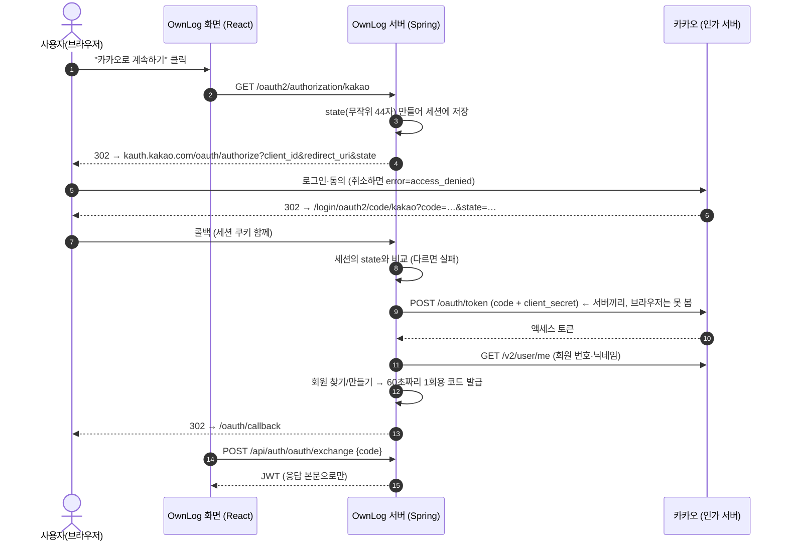
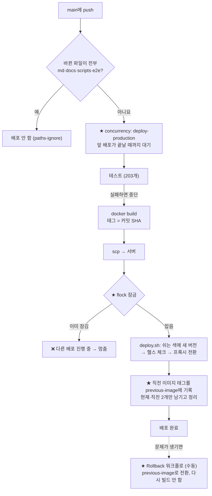

# 공부 노트: OAuth 키 설정 + 배포 구성 점검

> 2026-10-19 점검 기록이에요. 확인한 사실에는 `파일:라인` 근거를 붙였고, 코드로 확인하지 못한 것은 **추정**, 버전·환경마다 다른 것은 **확인 필요**로 표시했어요.
> 키·비밀번호 값은 이 문서 어디에도 없어요 (이름과 "있다/없다"만 적었어요).

---

## 1. 한 장 요약

1. **OAuth 설정 상태는 안전해요.** 키는 전부 `${ENV}`로 읽고(하드코딩 0), git 이력 109개 커밋에 진짜 키가 없어요. 운영 Redirect URI는 https로 고정돼요.
2. **로컬 비밀값이 공개 예시 값과 같았어요.** `.env`를 `.env.example`에서 복사한 뒤 값을 안 바꿨어요 → 로컬 DB 비밀번호·JWT 비밀키를 새로 만들고, DB 포트를 `127.0.0.1`로만 열었어요.
3. **로그인 실패 케이스를 가짜 키로 실제 카카오·깃허브에 보내 확인했어요.** 취소, 잘못된 code, 위조 state, 세션 없음 모두 로그인 화면으로 돌아가요. 취소는 "취소했어요"로 따로 안내하게 고쳤어요.
4. **배포는 겹칠 수 있었고, 롤백이 사실상 불가능했어요.** → Actions `concurrency` + 서버 `flock`으로 한 번에 하나만, 직전 이미지를 남겨 **Rollback 워크플로로 1~2분 안에 되돌리기**를 만들었어요.
5. **남은 위험:** 블루-그린 전환 순간에 로그인 중이던 사람은 실패할 수 있어요(세션이 서버 메모리에 있음). 다시 누르면 되고, 고치려면 설계 결정이 필요해요.

---

## 2. 흐름도

### 2-1. OAuth 로그인 (Authorization Code 흐름)

### 2-2. push → 배포 파이프라인 (오늘 바뀐 부분 ★)

---

## 3. 개념 정리

> 형식: **한 줄 정의 → 비유 → OwnLog에서는 → 잘못하면**

### 3-1. OAuth2 Authorization Code 흐름
- **정의:** 사용자의 비밀번호를 받지 않고, 다른 서비스(카카오 등)에게 "이 사람이 누구인지" 확인받는 표준 절차. 브라우저는 짧은 **code**만 나르고, 진짜 토큰은 서버끼리 주고받아요.
- **비유:** 호텔 프런트(카카오)가 손님에게 **교환권(code)**을 주면, 손님은 그걸 우리 가게(서버)에 건네고, 가게가 직접 프런트에 가서 교환권을 **열쇠(토큰)**로 바꿔 와요. 손님 손에는 열쇠가 쥐어지지 않아요.
- **OwnLog에서는:** Spring Security OAuth2 Client가 ①~⑪을 처리하고(`SecurityConfig.java:79-82`), 우리는 회원 찾기와 1회용 코드만 만들어요(`OAuthLoginHandlers.java:39`).
- **잘못하면:** 토큰을 주소창으로 바로 넘기는 방식(implicit)을 쓰면 토큰이 방문 기록·로그에 남아요.

### 3-2. client-secret
- **정의:** 우리 서버가 진짜 OwnLog 서버임을 카카오에 증명하는 비밀번호. client-id는 공개돼도 되지만 secret은 서버만 알아야 해요.
- **비유:** client-id는 가게 **간판**, secret은 가게 **도장**이에요. 간판은 누구나 보지만, 도장이 있어야 교환권을 열쇠로 바꿔 줘요.
- **OwnLog에서는:** `${OAUTH_KAKAO_CLIENT_SECRET:}`처럼 환경변수로만 읽어요(`application.yaml:35-45`). ID·SECRET이 **둘 다** 있어야 그 서비스가 켜져요(`OAuthProperties.java:21`).
- **잘못하면:** 코드나 커밋에 넣으면 누구나 우리 서버인 척 토큰을 받아 갈 수 있어요. 새면 파일 삭제가 아니라 **재발급**해야 해요(이력에 남아 있으니까).
- **오늘 확인:** 가짜 secret으로 실제 요청을 보내니 카카오는 `401`, 깃허브는 `404`를 돌려줬고, 우리 서버는 로그인 화면으로 돌려보냈어요.

### 3-3. redirect_uri
- **정의:** 동의가 끝난 뒤 카카오가 사용자를 돌려보낼 우리 주소. **콘솔에 미리 등록한 주소와 글자 하나까지 같아야** 해요.
- **비유:** 택배 반송 주소예요. 미리 등록한 주소가 아니면 택배사가 배달을 거부해요(남의 주소로 code를 빼돌리는 걸 막으려고).
- **OwnLog에서는:**

  | 환경 | 주소 | 근거 |
  |---|---|---|
  | 로컬 | `http://localhost:5173/login/oauth2/code/{kakao·naver·google·github}` | `public-url`이 비면 요청 주소로 계산 (`OAuthClientRegistrations.java:24-25`), Vite가 5173 → 8080 전달 (`vite.config.js:15-16`) |
  | 운영 | `https://ownlog.java21.net/login/oauth2/code/{…}` | `application-prod.yaml:29`에 고정 |

- **잘못하면:** `redirect_uri_mismatch`(카카오는 KOE006)로 **카카오 화면에서** 멈춰요. 우리 서버까지 오지도 않아서 우리 로그엔 안 남아요. Nginx 뒤에서 주소를 요청으로 계산하면 `http://`로 만들어져 불일치가 날 수 있는데, 운영은 https로 **고정**해서 이 문제가 없어요(`forward-headers-strategy: framework`도 켜 둠, `application-prod.yaml:20`).

### 3-4. state 파라미터
- **정의:** 로그인을 **시작한 그 브라우저**가 돌아온 건지 확인하는 무작위 값. 보낼 때 세션에 저장하고, 돌아올 때 비교해요.
- **비유:** 맡긴 짐의 **번호표**예요. 번호표가 다르거나 없으면 짐을 내주지 않아요.
- **OwnLog에서는:** 길이 44자 무작위 값이 세션에 저장돼요(오늘 실측). 위조된 state, 세션 없는 state 모두 `authorization_request_not_found`로 거부됐어요.
- **잘못하면:** state가 없으면 공격자가 **자기 code**를 피해자 브라우저에 밀어 넣어 피해자를 공격자 계정으로 로그인시킬 수 있어요(로그인 CSRF).
- **주의 (OwnLog):** state가 **서버 메모리 세션**에 있어서(`SecurityConfig.java:79-82`에 저장소 지정 없음 = 기본 세션, spring-session 없음), 블루-그린 전환 순간 blue에서 시작하고 green으로 돌아오면 실패해요. 오늘 "세션 없이 콜백"을 보내 같은 실패를 재현했어요.

### 3-5. 환경변수 vs GitHub Secrets vs 서버 .env
| | 어디에 있나 | 누가 읽나 | OwnLog에서 |
|---|---|---|---|
| **로컬 `.env`** | 내 컴퓨터 (git 제외, `.gitignore:10`) | 로컬 Spring·docker compose | 개발용 DB·JWT·(선택) OAuth 키 |
| **`.env.example`** | git에 **공개** | 사람 (어떤 키가 필요한지 보는 양식) | 키 **이름**만, 값은 비움 |
| **GitHub Secrets** | GitHub (값을 다시 볼 수 없음) | Actions 실행 중에만 | 운영 DB·SSH·JWT·OAuth |
| **환경변수** | 실행 중인 프로세스 안 | Spring의 `${…}` | Secrets → `deploy.yml:76~` → `deploy.sh`의 `docker run -e 이름`(`deploy.sh:124-125`) |
| **서버 .env** | 서버 | — | **안 써요.** 서버에는 `jwt.secret`(Secret이 없을 때만)만 있어요 |

- **비유:** `.env.example`은 빈 신청서, `.env`는 내가 채운 신청서(서랍 속), Secrets는 은행 금고(넣을 수는 있지만 꺼내 볼 수 없음), 환경변수는 금고에서 꺼내 **그 순간 손에 든** 값이에요.
- **잘못하면:** 오늘처럼 빈 신청서의 예시 값을 그대로 진짜 값으로 쓰면, 공개된 값이 곧 비밀번호가 돼요.

### 3-6. 이미지 태그 전략
- **정의:** 이미지에 붙이는 이름표. `latest`처럼 매번 덮어쓰는 이름이 아니라 **커밋 SHA**를 쓰면 "지금 무엇이 떠 있는지"와 "어디로 되돌릴지"가 분명해져요.
- **비유:** 사진 파일을 늘 `최종.jpg`로 덮어쓰면 어제 사진이 사라지지만, 날짜를 붙이면 골라서 꺼낼 수 있어요.
- **OwnLog에서는:** 처음부터 SHA 태그였어요(`deploy.yml:60-61, 76`). 그런데 배포할 때마다 **현재 것만 남기고 지워서**(예전 `deploy.sh`) 이름표는 있어도 사진이 없었어요 → 오늘 **현재 + 직전 2개**를 남기게 고쳤어요(`deploy.sh:103, 195-197, 210`).
- **잘못하면:** 롤백하려면 옛 커밋을 다시 빌드해야 해서 10분 넘게 걸리고, 그동안 장애가 계속돼요.

### 3-7. concurrency (동시 실행 막기)
- **정의:** 같은 그룹의 워크플로가 동시에 돌지 않게 줄을 세우는 Actions 설정.
- **비유:** 화장실 문 잠금이에요. 안에 사람이 있으면 밖에서 기다려요.
- **OwnLog에서는:** `deploy.yml:18-20`, `rollback.yml`이 같은 그룹 `deploy-production`. **진행 중인 배포는 취소하지 않아요**(`cancel-in-progress: false`). 서버가 반쯤 바뀐 상태로 남지 않게요. 기다리는 실행은 하나만 남고 더 새 push가 오면 오래된 대기는 취소돼요(가장 최신만 배포).
- **서버 쪽 이중 잠금:** Actions 밖에서 누가 `deploy.sh`를 직접 실행해도 겹치지 않게 `flock`을 걸었어요(`deploy.sh:37-44`).
- **잘못하면:** 두 배포가 둘 다 "지금 blue니까 green에 띄우자"로 판단해 **서로의 green을 지워요**(Race Condition).

### 3-8. paths 필터
- **정의:** 바뀐 파일 경로에 따라 워크플로를 돌릴지 정하는 설정.
- **OwnLog에서는:** `paths-ignore`로 md·docs·scripts·e2e만 바뀌면 배포 안 함(`deploy.yml:8-12`).
- **잘못하면:** `paths-ignore`는 **푸시한 파일이 전부** 목록에 맞을 때만 건너뛰어요. 하나라도 섞이면 배포돼요(트러블슈팅 20번, 문서 저장소).

---

## 4. 확인 결과표

| 영역 | 항목 | 현재 상태 | 문제 | 조치 |
|---|---|---|---|---|
| OAuth | 제공자·설정 위치 | 4종, 코드로 등록 (`OAuthClientRegistrations.java`) | 없음 | — |
| OAuth | 키 읽는 방식 | `${ENV:}`, 하드코딩 0 (`application.yaml:35-45`) | 없음 | `.env.example`에 키 이름 추가 (`618aac7`) |
| OAuth | `.env` git 제외 | `.gitignore:10`, 커밋 이력 없음 | 없음 | — |
| OAuth | 이력에 진짜 키 | 109커밋 검사: 키 형식 0건, `OAUTH_*`·secret 대입 0건 | 없음 | — |
| 로컬 | `.env` 값 | **`.env.example` 예시 값과 같았음** | ⚠️ | 로컬 DB 비밀번호·JWT 새로 생성 (값 미출력), 이력에 0건 확인 |
| 로컬 | DB 포트 | **`0.0.0.0:5432` (와이파이에서 접속 가능)** | ⚠️ | `127.0.0.1:5432`로 (`678e033`) |
| OAuth | 운영 redirect_uri http 위험 | https 고정 (`application-prod.yaml:29`) | 없음 | — |
| OAuth | 동의 취소 응답 | "실패"와 같은 문장 | 작은 문제 | "취소했어요" 따로 (`7606c84`) |
| OAuth | 잘못된 secret·code / 위조 state | 모두 `/login?oauthError=failed` | 없음 | 실측 (카카오 401, 깃허브 404) |
| OAuth | 동시 첫 로그인 중복 회원 | `UNIQUE(provider, provider_user_id)` (`V6__social_login.sql:20`) | 없음 | 동시 2건 테스트 추가 → 회원·블로그 1개 |
| OAuth | 블루-그린 중 로그인 | state·1회용 코드가 서버 메모리 | ⚠️ 드묾 | **결정 필요** (6장, 9장) |
| 배포 | 트리거 | main만, 문서·e2e 제외 | 없음 | — |
| 배포 | 동시 배포 | 막는 장치 없음 | ❌ | `concurrency` + `flock` (`9fb8acb`) |
| 배포 | Dockerfile | 멀티 스테이지, 시크릿 없음, `USER ownlog`(비 root, `Dockerfile:26`) | 없음 | — |
| 배포 | 이미지 태그 | 커밋 SHA | 없음 | — |
| 배포 | 키 주입 | `docker run -e 이름` | 없음 | — |
| 배포 | 롤백 | 직전 이미지를 지워서 재빌드 필요 | ❌ | 직전 이미지 유지 + `rollback.yml` (`9fb8acb`) |

---

## 5. 변경 내역

| 커밋 | 무엇을 | 왜 | 핵심 diff |
|---|---|---|---|
| `678e033` chore | 로컬 DB 포트 제한 | 와이파이에서 공개된 비밀번호로 접속 가능했음 | `docker-compose.yml`: `"5432:5432"` → `"127.0.0.1:5432:5432"` |
| `618aac7` chore | `.env.example`에 OAuth 키 이름 | 어떤 키를 채워야 하는지 알 수 있게 (값은 비움) | `OAUTH_{KAKAO,…}_CLIENT_{ID,SECRET}=`, `PUBLIC_URL=` |
| `7606c84` fix | 취소 안내 분리 + 동시 첫 로그인 테스트 | 취소는 오류가 아니라 선택 | `access_denied` → `oauthError=cancelled` (`OAuthLoginHandlers.java:56-58`), `LoginPage.jsx` 문장 추가, `SocialLoginTest` 11·12번 |
| `9fb8acb` ci | 동시 배포 막기 + 롤백 | 겹치면 컨테이너를 서로 지움, 롤백에 재빌드 필요 | `deploy.yml`: `concurrency`, `deploy.sh`: `flock`·`previous-image`·`grep -vx -e 현재 -e 직전`, 새 `rollback.yml` |
| (커밋 없음) | 로컬 `.env` 비밀값 교체 | 예시 값과 같았음 | `.env`는 git 밖이라 커밋 대상이 아니에요. DB는 `ALTER USER`로 같은 값으로 맞춤 |

---

## 6. 트러블슈팅 (오늘 실제로 겪은 것)

### 6-1. 로컬 비밀값이 공개 예시 값과 같았음
- **문제:** git 이력에서 비밀값을 찾는 검사 중, 로컬 `.env`의 `DB_PASSWORD`·`JWT_SECRET` 값이 이력 3곳에서 발견됨.
- **원인:** 처음에 `cp .env.example .env` 하고 값을 안 바꿨어요. 발견된 곳은 `.env.example`과 개발환경 가이드(예시 값을 보여 주는 표)였어요 → **유출이 아니라 "공개 값을 비밀번호로 쓰는 중"**이었어요. 게다가 DB 포트가 와이파이에 열려 있었어요.
- **해결:** ① DB 포트 `127.0.0.1`로 ② 무작위 새 값 생성 → `ALTER USER`로 DB 비밀번호 변경 → `.env` 교체 (화면에 값 출력 없이) ③ 백엔드 재시작.
- **결과:** 와이파이 IP로 5432 "막힘", 127.0.0.1 "열림", 새 비밀번호로 DB 로그인 OK, 새 값은 예시와 다르고 이력 0건, 로그인(JWT) OK.

### 6-2. 롤백 시험에서 "미리 만든 시험 이미지"가 사라짐
- **문제:** 로컬에서 배포 4번(첫 배포 → 새 버전 → 롤백 → 새 버전)을 시험하는데, 두 번째부터 `IMAGE_TAG` 이미지를 찾지 못함.
- **원인:** 시험 이미지 3개를 **미리** 만들어 뒀는데, 첫 배포의 정리 단계가 "현재·직전 말고는 삭제"라서 나머지를 지웠어요. 서버에서는 방금 올린 이미지만 있으니 정상 동작이고, **시험 방법이 운영 상황과 달랐던** 거예요.
- **해결:** 배포 **직전에** 이미지를 만들도록 시험 순서를 바꿈 (운영에서 scp로 새 이미지가 올라오는 것과 같은 순서).
- **결과:** 4번 모두 성공. 매번 남은 이미지가 "현재 + 직전" 2개였고, 롤백은 다시 빌드하지 않고 전환됐어요.

---

## 7. 직접 쳐볼 명령어 5개

| # | 명령 | 예상 결과 |
|---|---|---|
| 1 | `lsof -iTCP:5432 -sTCP:LISTEN -P -n` | `127.0.0.1:5432` (전에는 `*:5432`) |
| 2 | `nc -z -G 3 $(ipconfig getifaddr en0) 5432 && echo 열림 \|\| echo 막힘` | `막힘` (와이파이 주소로는 DB에 못 들어와요) |
| 3 | `curl -s localhost:8080/api/auth/oauth/providers` | `{"providers":[]}` (키를 넣기 전). `.env`에 카카오 ID·SECRET을 넣고 재시작하면 `["kakao"]` |
| 4 | `curl -s -o /dev/null -w '%{redirect_url}\n' localhost:8080/oauth2/authorization/kakao` | 키가 있으면 `https://kauth.kakao.com/oauth/authorize?…state=…`. 키가 없으면 소셜 로그인이 꺼져 있어 **404** (로컬 개발 서버는 화면 파일이 없어서, 2026-10-19 실측) |
| 5 | `bash -n deploy/deploy.sh && grep -n "concurrency" -A2 .github/workflows/deploy.yml` | 아무 오류 없이 `group: deploy-production`, `cancel-in-progress: false` |

---

## 8. 면접 예상 질문 5개

**Q1. OAuth 키를 어떻게 관리했나요?**
코드에는 `${OAUTH_KAKAO_CLIENT_ID:}`처럼 이름만 두고, 값은 로컬 `.env`(git 제외)와 GitHub Secrets에만 넣었습니다. 배포 때는 Secrets → 환경변수 → `docker run -e 이름`으로 넘겨서 명령 기록·로그·이미지 레이어에 값이 남지 않게 했습니다. 이력 109개 커밋을 검사해 진짜 키가 없음을 확인했고, 키가 없으면 그 로그인 버튼만 숨겨지게 해서 키 없이도 안전하게 배포됩니다.

**Q2. 배포 후 문제가 생기면 어떻게 롤백하나요?**
이미지 태그를 커밋 SHA로 붙이고, 배포 스크립트가 직전 이미지를 지우지 않고 남겨 두게 했습니다. Actions의 Rollback 워크플로를 실행하면 다시 빌드하지 않고 직전 이미지로 블루-그린 전환만 해서 1~2분 안에 되돌아갑니다. 로컬에서 "새 버전 → 롤백 → 새 버전" 순서로 실제로 전환되는 것을 확인했습니다.

**Q3. 배포가 동시에 두 번 돌면 어떻게 되나요?**
둘 다 같은 색을 골라 서로의 컨테이너를 지울 수 있는 Race Condition이 있었습니다. GitHub Actions `concurrency`로 줄을 세우고(진행 중 배포는 취소하지 않음), 서버에서도 `flock`으로 잠가 이중으로 막았습니다. 리눅스 컨테이너에서 두 번째 실행이 바로 멈추는 것을 확인했습니다.

**Q4. state 파라미터는 왜 필요한가요?**
로그인을 시작한 브라우저가 돌아온 건지 확인하는 값입니다. 없으면 공격자가 자기 code를 피해자 브라우저에 넣어 공격자 계정으로 로그인시키는 로그인 CSRF가 가능합니다. 우리 서비스는 Spring이 세션에 저장·비교하고, 위조 state로 콜백을 보내 거부되는 것을 확인했습니다. 다만 세션이 서버 메모리라 블루-그린 전환 순간엔 정상 사용자도 실패할 수 있어 개선 과제로 남겼습니다.

**Q5. Nginx 뒤에서 OAuth redirect_uri가 http로 만들어지는 문제를 아나요?**
TLS를 앞단 Nginx에서 끝내면 앱은 http 요청을 받아서, 요청으로 주소를 계산하면 `http://…`가 되어 등록한 https 주소와 불일치합니다. `X-Forwarded-Proto`를 믿도록 `forward-headers-strategy`를 켜는 방법이 있고, 저희는 추가로 운영 Redirect URI를 https로 고정해 헤더에 의존하지 않게 했습니다.

---

## 9. 아직 모르는 것 (다음 공부 거리)

- **블루-그린 + 세션:** state를 서명한 쿠키에 둘지, DB(spring-session)에 둘지, 장단점과 보안 차이.
- **실제 키로 확인하지 못한 것:** `redirect_uri_mismatch`가 각 서비스에서 어떤 화면으로 보이는지, 네이버가 Callback URL을 몇 개까지 받는지 (**확인 필요**), 카카오가 secret 없이 동작하는 설정일 때의 차이.
- **운영 JWT_SECRET:** Secrets 값은 다시 볼 수 없어서, 예시 값을 넣었는지 확인할 수 없어요. 새로 만들어 덮어쓸지 결정 필요 (덮어쓰면 모두 한 번 로그아웃).
- **서버의 flock:** Ubuntu에 기본으로 있다고 알고 있지만 (util-linux) 우리 서버에서 직접 확인하지 못했어요 (**확인 필요**, `command -v flock`).
- **concurrency의 대기 규칙:** "대기 중인 실행은 하나만 남는다"는 GitHub 문서 기준이에요. 실제로 연속 push 3번을 해서 확인해 보기.
- **Hibernate AUTO flush:** 어떤 쿼리 앞에서 자동으로 flush하는지 (JPQL·네이티브 차이, 버전별 차이 **확인 필요**).
